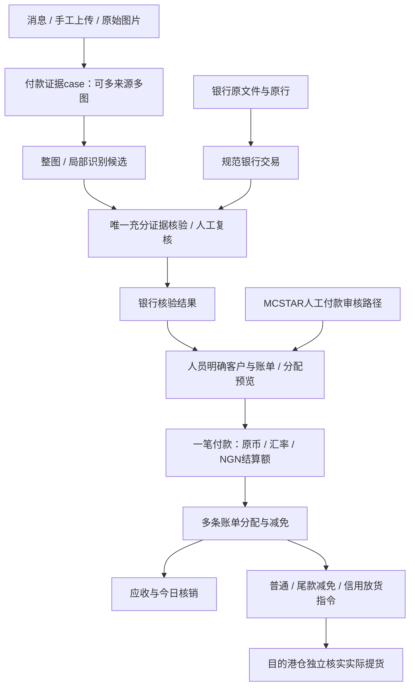

# 110完整集成方案

结论：复用110的识别、核对、证据和交互能力，通过统一业务服务与PostgreSQL适配接入MCSTAR；不把110网页套进iframe，也不把“核对通过”直接写成“客户账单已结清”。本文件是待实现的设计；没有启动旧账号、发送消息或调用模型。

## 1. 已检查的能力与复用方式

以下路径均指只读参考目录`D:\work\110`。源码存在不等于新项目已验证；历史测试和上线记录均保留其日期与适用范围。

| 现有模块 | 源码实际能力 | 接入统一项目的改造 |
| --- | --- | --- |
| `intake/store.py` | 消息唯一、签名接收后的持久保存、下载任务、SQLite WAL/租约字段 | 保留来源与幂等语义，重写PostgreSQL仓储层；不直接替换连接串假装兼容。 |
| `evidence.py`、`recognition_context.py` | 原图/群文字、回复关联、来源与相似重复候选、消息级上下文 | 统一附件与来源ID；相似图只待核，同图多来源都保留；不按消息相邻就强关联。 |
| `recognition.py`、`image_prep.py`、一致性/验证模块 | 整图多模态、关键区域复识别，原候选与规范值分离、缺失值保留 | 复用算法与模型适配；移植队列、配置、缓存键及人工修正优先级，禁止全历史自动重跑。 |
| `bank.py`、`bank_imports.py`、`bank_schema.py` | XLS/XLSX预览、原文件、工作表映射、原始贷借方/参考号/日期、fingerprint | 按统一银行账户主数据适配；保留原始行，区分跨文件同交易与合法同额不同交易。 |
| `reconciliation.py` | Decimal、多字段核对、唯一候选与歧义原因、跨凭证争用、历史确认 | 复用确定性规则并增加明确策略范围；优化候选检索，不改变结果语义。 |
| `workflow.py`、`workflow_bank.py` | case版本、人工确认、唯一银行占用、来源/结算汇率、inbox/outbox、sample/live隔离 | 将银行确认映射到统一银行核验；再由独立付款服务绑定MCSTAR账单，不重复记款。 |
| `workflow_archive.py`、`archive_delivery.py` | 原Excel模板XML保真追加、数字/日期、模板哈希、归档快照与投递记录 | 统一文件存储与模板注册；保留NGN模板适用范围，新增客户箱单不复用错误列结构。 |
| `entry_services.py`、`entry_worker.py`、dialogue相关 | 网页/授权小号共用意图、原图与银行查询、复核动作、结果以实际执行为准 | 统一actor、权限、case/付款/账单版本；新增结构化业务引用与确认预览。 |
| `channels.py`、`channel_routes.py` | 主号只读、操作人员/发送目标限制、双入口、后续回复 | 保留角色边界、采集起点与选择群；来源群成员不等于被授权财务操作员。 |
| `connections.py`、`connection_health.py`、`pairing_diagnostics.py` | 状态追踪、冷却、有限恢复、二维码条件与线路诊断 | 复用受控策略，不在迁移自动启动/重登；保护现有身份与会话。 |
| `image_summaries.py`、`echo.py` | 摘要/回显的配置、队列、去重与不确定投递处理 | 配置和历史保存；原暂停继续暂停，不因为能力存在自动启用。 |
| `auth.py`、`portal.py`、React前端 | 旧公开入口可自动给会话；网页凭证、候选、对话和归档页面 | 统一登录和能力，替换公开自动会话；复用操作内容，页面布局服从MCSTAR最终需求。 |

## 2. 银行、付款、账单的连接

1. `case_id`表明证据处理对象，`bank_entry_id`表明到账交易，`payment_id`表明业务付款；三者不能用同一个收据号代替。凭证上的`business_reference`与银行`transaction_reference`分开。
2. 提取到收据号/柜号只形成业务候选。一个收据号多行/分批，或只识别到柜号时不能默选该柜全部账单；姓名相似、群发送者电话也不是客户归属证明。
3. 人员明确选单，可输入多个收据号、查当前有效账单并逐张确认分配；显示总款、已分配、剩余额、折扣、币种与本笔汇率。跨客户分配需明确授权及证据，不因选择多个单号自动归为同客。
4. 同一银行到账一笔付款唯一，多张证明图作为证据附加，不重复付款。两张同金额同日图如果是不同交易必须分别保留；无法证明相同则进入重复复核，不自动吞掉。
5. 点击核销以数据库实际事务为准：锁定case/银行占用/付款/账单版本，写审核、分配、减免、审计、通知待办；重试返回同一结果。并发抢同一银行行只有一个成功，其余明确冲突。
6. 保留原MCSTAR人工审核路径。不强迫每条历史水单具备银行文件，也不把“人工审核过”伪装成银行到账；两类证据在界面可区分。
7. 厂家ON HOLD不由银行核对、运费已收或运费信用放货解除；放货前必须核实独立解控状态。多票合并只对符合各自放货条件的成员生成有效指令，不能由其中一票已付款推定全组可放。
8. 新到的110证据若对应既有MCSTAR付款，执行“补银行证据”而不是“新增收款”。必须明确选择既有付款并校验版本/银行占用；补证不新增分配、不改变已收、不刷新核销日期。跨来源无法判定的记录先待关联，不直接再记一次。

## 3. 核对算法与特殊规则

基础过滤为正确币种、有效贷方收入、非支出、原行无阻断问题。结合准确交易日、收款账户、交易参考号、付款人和银行证据；金额日期相同但身份不明确仍待核。日期缺失或推断值保留来源与候选，不能把收图日直接当银行交易日。银行覆盖不足返回“等待流水/覆盖未知”，不返回“客户未付款”。

当前源码`reconciliation.py`149及178—180行对NGN53.75差额有泛化处理，而历史说明的授权是具体样本。新项目保留已审核旧结果和原理由；新笔只有命中明确的策略范围、授权证据和版本才能自动接受，否则待核。不得把MCSTAR NGN5000尾款减免、银行手续费、汇率差或日期推测扩大为全局自动匹配容差。

银行原始行身份为原文件SHA+sheet+原行号，全部保留。规范交易身份优先银行账户+可信原交易ID；原fingerprint可识别跨文件重叠候选，但同字段值不一定等于同一笔。没有可靠银行唯一编号、存在同表重复行或同指纹冲突时，保留每行并要求复核，不能沿用`setdefault(fingerprint)`吞掉合法第二笔。导入110已确认占用时保留旧fingerprint映射及范围，不能因新标准化变化释放历史占用后再认一遍。

优化仅缩小检索所需扫描：币种/金额/账户索引、批量哈希桶、revision与受影响候选增量任务。新旧匹配器对同一脱敏基准必须输出相同候选/原因；新增的安全范围变化逐例解释。缺日期候选和冲突候选不能被“优化”删掉。

## 4. 网页与授权小号一致

两入口共用业务服务，差异仅为呈现：网页显示原图、候选、账单分配预览；WhatsApp返回可定位case的摘要、原图/文件和明确动作预览。复核指令绑定当前case版本、目标银行行和账单分配版本。用户回复“第二张”只沿用该张证据，不能沿用另一张当前版本。询问、条件句和讨论不执行核销；模型未提交有效动作不能回复“已经完成”。

原110会确认银行行/排除/暂缓/撤回；新增MCSTAR账单核销默认须明确分配。若小号无法完整表达/展示多票分配，则给受鉴权网页链接继续确认，不省略步骤直接自动记账。消息按钮或链接携带nonce、有效期和版本，过期重取当前信息。授权手机号不自动映射成客户收货电话。

图片摘要与原群回显保留配置和历史，但暂停状态延续；不向源群自动发客户费用、不自动创建客户群。生成/复制通知与真实投递分别记录。主号禁止发送与已读，小号只向经过允许的操作人员/群发送已授权结果；网页提交任务不会默认群发。

## 5. 数据库与队列移植

1. 把`sqlite3.connect`、`PRAGMA`、`?`参数、`INSERT OR IGNORE`、整数自增、时间戳和`BEGIN IMMEDIATE`逐处改为PostgreSQL事务/仓储。只复用纯函数无需改写其业务含义。
2. 用显式行锁、部分唯一索引和版本条件保留`workflow_ledger`银行唯一占用；财务分配也必须同一事务。冲突/死锁可有限重试，但请求体和幂等结果固定。
3. 配置、recognition、workflow、entry、dialogue、image_summary、archive各队列列入迁移清单。任务租约迁入先失效，运行中任务转待核/暂停；已送达及发送不确定记录不重放。队列编号保留来源映射。
4. 单写者代际`generation`隔离旧新接收/外发，Webhook先持久化并幂等，再执行业务。切换窗口保留事件游标与缺口，未补采不得声称零丢失；旧系统不能和新系统同时对同一范围入账/发消息。
5. FastAPI进程不自动创建全部Worker；通过部署开关独立启用下载、模型、核对、导出、对话和投递。迁移环境这些开关关闭，不能使用真实账号和付费模型跑测试。

### 已记账后证据变化的衔接

原`workflow.py`约320、407—412、492—495、551—552行在来源变化或复核时可能释放case银行占用。统一系统不能照搬该副作用。银行claim一旦转给已核销payment，证据引擎只可提出争议，不可删除claim、取消账单分配或自动重用银行款。

`verified_unallocated`（110已确认未分配）、`posted`（已归付款）和`disputed`（争议冻结）都参与银行唯一占用；`released`才可再关联。case改正/暂缓/撤回或模型重识别对posted款只记争议与版本，冻结新分配及未发送的有效放货待办，保留原财务金额。财务人员显式执行付款冲正时，反向分配/历史余额层调整、claim处理和审计同事务；无法说明原付款是否仍有效时继续保留disputed。已送达信息及实际提货不被数据库撤回。

网页与小号须明确区分“修正证据”和“冲正付款”；后者要求单独能力、当前版本、影响预览及明确确认，不能把一句“这张图识别错了”解释成自动撤销全部收款。

## 6. 原能力保留与新能力边界

保留来源图片、来源群/发送者/时间、明确回复关联、相似候选、银行导入预览、人工复核/撤回、原模板归档、双入口查询文件、连接状态和配置。新增结构化账单引用、分配和统一权限；不同时引入新的OCR平台、客服营销机器人或替换模型供应商。

110当前生产会话、正式数据库、真实配对和新版引擎上线状态未在本次重新验证。旧README中的某日测试/上线记录只能说明当时情况。正式接入前必须取得一致性备份及脱敏运行配置、核实会话身份和启用状态；不因“本地有代码”跳过这些验收。

## 7. 必须通过的接入用例

| 用例 | 正确结果 |
| --- | --- |
| 同一消息Webhook重投/同一图多次发送 | 消息不重复处理，同图来源全部可查；不因多来源重复记款。 |
| 两笔同日同额同付款人、不同可信银行交易ID | 两笔都保留，各自占用、核销和归档。 |
| 一笔银行款分3张单/1张单由3笔付款结清 | 分配与原款一致，无越额、无丢失、今日核销无重复。 |
| 银行已确认但不知道收据号 | 保留已确认未分配，不生成任意客户结清或放货。 |
| 两操作员抢同银行行或用旧复核版本 | 一人成功；另一人收到当前版本/占用冲突，不重复提交。 |
| 金额差53.75但没有适用授权 | 进入待核，不自动套用历史例外。 |
| 昨日付款、今日核销，跨日重新复制通知 | 今日核销显示今天；付款日仍是昨天；通知签发日为此次生成日。 |
| 撤回银行确认但目的港已真实提货 | 银行/账款显示待处理与反向记录，实物提货事实仍保留。 |
| 暂停配置迁移/不确定发送记录 | 新旧均不自动外发、历史不重放；状态仍可查看。 |
