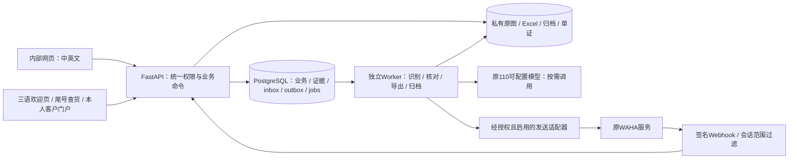

# 110-ALL 完整统一设计

日期：2026-11-04。状态：**设计交付，待实现与实际验收**。位置：`D:\work\110-ALL`。依据为[146项清单](../../requirements/必须遵守的功能清单.md)、[指令冲突处置](../../requirements/冲突与待确认事项.md)与已读的两套源码，不是仅根据功能宣传设计。

## 1. 选择与边界

新建统一系统，沿用110的 FastAPI 与 React 技术基础，把MCSTAR的仓储、箱单、应收应付、通知、节点和客户入口拆为业务模块。以 PostgreSQL18作为统一权威数据库；附件从JSON/base64拆到私有文件存储。首次部署使用私有本地卷，接口抽象支持以后替换对象存储，不同时引入第二套必须运营的存储平台。

统一的是账号、业务身份、账款和证据关系；WAHA仍作为独立外部服务。110中值得复用的是已存在的消息来源、识别、银行导入、人工复核、版本和归档实现。SQLite专用SQL、公开免密入口及旧连接启动配置不能原样复制。MCSTAR旧HTML用于字段/流程/版式参照，不嵌成新系统中的第二套写库页面。

完整范围包括全部需求组，没有默认缩减为MVP。文档先完成；应用源码、生产迁移、模型调用、消息发送和域名发布尚未执行。旧项目与原ZIP不改动。

## 2. 服务、模块与目录



上图是目标设计，不能据此推断当前消息采集、模型或外发已启用。

| 模块 | 包含的完整功能 | 需求组 |
| --- | --- | --- |
| 身份与工作台 | 统一登录、动作权限、账号、统计、搜索、公告、审计、可靠保存 | SYS、AR、AP |
| 中国仓与F6 | 入库、多规格、照片、品名翻译、改包/压包、复核、断号、外部F6导入、前日分析、业务员下钻 | WH、F6 |
| 出运与箱单 | SEA/AIR/EXPRESS/仓储、原始行、分票、改港、分批出库/到货、重传版本、客户箱单 | SHIP、PL、DOC |
| 价目与资料 | 多通道有效期价目、手工例外、币种、计价单位、客户/供应商及各仓 | RATE、PARTY |
| 财务 | 双币应收、周期应付、折扣、合并付款/分配、信用放货、今日核销、PDF/Excel | AR、AP、PAY |
| 付款证据 | 原图/消息、整图与局部识别、银行Excel、唯一到账核验、人工复核、归档、双入口 | INT、PAY |
| 通知与放货 | 收货、到货、装柜、放货、解控、文本/图片、通知标记与撤销、实际放货 | NOT、REL |
| 标签与单证 | 76×130标签、费用/确认/普通标签、MBL、B/O、SI、S/O、DN范围 | LABEL、MBL、DOC |
| 节点与客户 | 主分节点、实际仓库放货照片、尾号查货、快递查货、本人注册导出 | TRACK、PORTAL |
| 公司首页 | 三语、六服务板块、原图、热线、仓库资料及客户入口 | HOME |
| 迁移与运维 | 来源证明、全域回填、异常、备份恢复、切换、防重放 | MIG、SYS、INT |

目标目录如下，**这是实现布局设计，当前未创建假应用代码或空壳业务模块**：

```text
backend/app/
  api/                 # internal、customer、tracking、webhooks分开路由与权限
  identity/ common/    # actor、money、clock、versions、idempotency、audit
  warehouses/ cargo/   # 入库、规格、库存变动、分批与货物身份
  shipments/ packing/  # 出运、原始箱单、分票、版本和客户归组
  pricing/ parties/    # 价目、单位、仓库/客户资料
  finance/             # AR、AP、payment、allocation、discount、release
  evidence/ bank/      # 从110迁入的候选识别、流水与核对
  channels/ dialogue/  # 110消息、授权双入口、投递状态
  documents/ tracking/ # 模板、导出、通知、节点和客户查货
  repositories/        # PostgreSQL事务和查询适配；不透传SQLite连接
  workers/             # 可独立关闭的持久化任务执行器
backend/migrations/    # Alembic：可回滚或明确不可逆的数据变更
web/src/features/      # 与上述业务模块对应，复用110的可用交互与组件
tools/migration/       # 后续实现：manifest、stage、reconcile、apply、verify
deploy/                # 后续实现：HTTPS、进程、健康检查与恢复说明
docs/                  # 本次实际交付
```

## 3. 统一身份与关系模型

### 3.1 核心实体

所有业务实体有内部UUID、`row_version`、创建/更新时间、操作者、来源引用及可追溯作废状态。内部ID不使用可能多行重复的收据号/柜号或客户姓名。`legacy_refs`唯一约束为`(source_system, source_dataset, entity_type, source_record_key)`；同一数据集后续快照视作增量版本，不能换一个文件哈希就把全部历史账再建一遍。

| 目标实体/关系 | 内容与约束 |
| --- | --- |
| users / roles / capabilities / grants | 身份、动作及范围权限；敏感字段服务端控制；旧账号身份可迁但不能激活旧令牌。 |
| parties / party_contacts / warehouses | 客户与成本方可多分类；联系电话原文、规范值、来源并存；同名不自动合并。仓库与地理目的港分开。 |
| receipts / cargo_lots / cargo_specs | 一个仓储收据身份下多行货物、多规格、多来源记录；`receipts(series,normalized_no)`唯一；历史归属有歧义先stage，不强行合票。 |
| cargo_movements / movement_lines | 中国仓入库、改包、压包、出库、退回的不可变事件；每行带件/KG/CBM及来源批次。剩余按有效事件求和。 |
| shipments / shipment_lots / arrivals | 柜/航班/出运单、原始明细与承运分配、目的港分批到货；一收据可跨批，明细保持原序。 |
| packing_documents / source_rows / revisions | 文件、sheet、行号、原字段、版本、字段级差异；有效版本一个，原件永不被新文件覆盖。 |
| price_cards / price_lines / quote_snapshots | 通道、普/特货、始发地、目的港、币种、KG/PCS/CBM、生效范围；本票命中版本和手改者固定留档。 |
| invoices / invoice_lines / bill_groups | 应收/应付分类型，历史金额/期限保留；一票或合并组对应的原始货行可多对多引用，不能只存文本串。 |
| payments / payment_evidence / allocations | 真实付款、原图/多图证据及账单分配；付款可分多账，账单可分多次收款；未分配余额留在付款/客户账户。 |
| discounts / adjustments / credit_terms | 减免、历史差异调整、信用放货承诺独立于付款；不伪造银行行。 |
| payable_settlements / payable_payments | 账单方+周期总账与独立付款；可不分配到单柜，内部保留周期关系。 |
| bank_files / bank_source_rows / bank_entries / bank_claims | 原文件原行与规范交易分开；可信银行交易身份及有效占用唯一；重复上传不删原始来源。 |
| evidence_cases / recognition_candidates / reviews | 110来源、整图/局部候选、人工意见、版本和银行核验；既有JSON详情可用JSONB保留，但账款关系不用JSONB藏键。 |
| release_orders / credit_releases / hold_events / physical_releases | 指令、信用授权、控货/解控和目的港实际提货分别建模；取消走反向事件。 |
| node_events / node_overrides | 主单共享事件与每票每节点follow/manual；实际放货不继承。 |
| notifications / notification_members / delivery_attempts | 生成/复制和实际投递分别记录；合并组快照保存当次成员，撤销不受后来改组影响。 |
| mbls / shipping_documents / attachments | MBL字段、B/O/SI/DN等版本、船东S/O原件及附件权限。 |
| inbox / outbox / jobs / audit_events | 幂等事件、持久任务、投递状态、操作前后版本；已提交业务和待导出附件可分阶段，不能把未导出说成失败核销。 |
| migration_runs / staged_records / issues / source_map | 导入批次、原始字节定位、版本、异常、人工处置与来源映射。 |

### 3.2 账款的强制不变量

1. 付款原币金额、实际银行贷记、NGN结算额、汇率和手续费分别保存。费用币种、付款币种与结算币种不混为一个字段。NGN原生款直接按1换算；其他币种缺本笔汇率不能自动核销。
2. 新应收按USD部分×本票结算汇率+NGN部分形成一张账单；空运NGN/PCS直接按件相乘。历史原金额不因新算法自动重算。
3. 有效分配之和≤该付款可分配结算额。账单未结=账单有效金额−有效减免−有效已收；超付保留为未分配余额，不能丢弃或自动转给他人。
4. 同一有效银行交易只能支持一笔业务付款；一笔付款可以有多张证明图，且可分给多账。多图是同笔还是多笔必须有证据/人工决定，不按相同金额自动吞并。
5. 核销提交锁定付款与目标账单版本，在同一事务写分配、审核、审计及outbox。唯一约束和余额检查是最后防线，前端按钮灰化不能替代它们。
6. 审核撤回、放货取消、单据作废用反向记录，保存原证据与操作者。银行核验撤回不抹除已经发生的实物放货；显示冲突待处理。
7. 新金额用Python Decimal / PostgreSQL NUMERIC，JSON返回十进制字符串；浏览器不能用浮点数作为财务权威。金额`numeric(20,2)`、汇率`numeric(20,6)`、KG/CBM`numeric(20,6)`，大值输入及舍入边界须验证。

汇率记录必须带base/quote币种、方向、适用时点、来源和确认者，不能只有一个无单位的rate。直接换算统一表示“1原币=多少NGN”；若采用110原模板的NGN_per_USD和CNY_per_USD交叉率，CNY付款按`CNY金额 ÷ CNY_per_USD × NGN_per_USD`计算并保存路径，不能把CNY_per_USD当NGN_per_CNY乘。缺任何环节或旧字段方向不明确时保留原始结果与待核状态，不倒推新的历史汇率。

**银行占用生命周期：** `verified_unallocated → posted`表示由已核验case保留占用，再原子转给付款；`disputed`仍占用，不能被另一case/付款重用。唯一索引覆盖这三种有效状态，只有`released`解除唯一占用。多张证据可附在同一付款但不各建一份占用。迁入110已确认但未绑定MCSTAR的银行记录仍保留`verified_unallocated`占用，不能因暂未建付款而成为可再领的银行行。

证据重识别、correct、defer、retract与付款冲正是不同命令。已经post的付款遇到证据变化，case转待核、claim转disputed并冻结相关新分配/有效放货待办，账款不自动改动。只有具备`payment.reverse`能力的人员明确查看当前分配、信用/实放影响并确认冲正，才能按版本在同事务写反向分配与对应历史余额层调整；确认不再支持任何有效款项后才释放/转移claim。已发生实物放货和已投递回执保留，未发指令可取消，发送不确定仍待核。不能直接复用110的自动`release()`去删除已入账付款的占用。

### 3.3 不合并的状态

| 维度 | 示例状态 | 不能推出的事实 |
| --- | --- | --- |
| 凭证 | 待识别/候选/待审核/人工确认 | 图片读出金额≠已到账。 |
| 银行核验 | 未取得流水/待核/已确认/撤回 | 已到账≠账单归属已知。 |
| 财务核销 | 未分配/部分分配/已核销/已撤销 | 核销≠仓库已提货。 |
| 控货 | 控货/已解除/解除被撤销 | 解控≠放货，REMOVED ON CREDIT文案不生成信用事件。 |
| 指令 | 正常放货/尾款减免放货/信用放货/取消 | 已生成或已复制≠客户收到，指令≠实际提货。 |
| 物流 | 中国在库/已出库/运输/目的港在库/已实放 | 中国已出库≠目的港已放货。 |

已有MCSTAR人工核销仍按历史状态保留；没有银行证据时银行状态为未知，不回滚历史已收，也不补造“银行验证通过”。

## 4. 完整业务流程

### 4.1 收货、库存和出运

录入收据号、运输方式、客户/供应商联系方式、目的港与库房，支持至少20行规格及照片。自动计算体积前明确长宽高单位，保留原输入；中文品名原值与英文翻译候选分列，人工编辑后不被异步翻译覆盖。无电话不补同名客户号码。新收据号通过数据库唯一约束与序列锁生成，作废仍占号；断号提示只在同系列/定义的有效范围内检查，不因导入缺历史号生成假记录。

改包、压包、合并来源及作废保存前后规格、事件与复核状态。复核绑定版本，变更后旧复核不能继续有效。出库从明确批次/详情入口操作：选择多票、每票部分件/KG/CBM、柜号/航班和经手人，事务内检查剩余，支持同收据分批。中国出库生成运输关联，不生成目的港放货。

导入F6或箱单先预览原文件、sheet和行映射，识别英文件、草稿、多表、合并单元格以及TOTAL边界。原始行和同号续行均保留；标准化字段、人工修正与来源值分开。不能因行内数据不全而丢行。按客户目的仓而非整柜港口选地址。每次上传独立文档；替换必须明确目标版本，对照差异后更新既有货物/应收关系，不丢水单、折扣、通知和到货标记。

收费卡按通道、始发地、目的港、货类和收货日命中一个有效版本，保留293中广州/香港始发差异；重叠或无报价时待人工，不猜一张。目的港/运输方式变化先计算差异、展示手工覆盖，保存正确币种与单位；USD/KG不能直接填到NGN/PCS。未到港不自动生新应收；既有历史应收不按此新建规则反删。空运可分批到货，按记录分摊重量和费用，固定分配舍入余数。

### 4.2 应收应付与证据核对

应收按出运文档/客户范围查看，可从收据号、客户、逾期和今日核销跳转。合并组在同子单内按用户要求的唛头或已确认真实电话产生，同时显示组成票件；不据此把全库同名客户合为一个身份。分组预览暴露电话冲突与跨目的仓差异，不能把多个目的仓压成错误单一地址。

水单从粘贴、多文件上传或110授权消息进入统一证据库。识别生成候选，不提前入账；银行核对和账单归属是两个检查。人员可保留原MCSTAR人工审核路径，也可对110已核验的款项选定账单分配后核销。提交成功后留在原弹窗，可看/复制文字与图片放货指令、切换信用放货；后台导出失败不撤销已完成账款，提供独立重试状态。

手工减免与信用放货不修改银行实收。NGN5000以内尾款按原规则允许减免放货；系统提交明确减免额和操作者，不能仅以一段文字把账面尾款消掉。超付、旧欠和本期未结分别展示，今日核销按服务端审核通过时间计入本地业务日，不用付款日替代。

厂家ON HOLD与物流费用欠款分别保存：付清运费或获得运费信用放货不能解除厂家控货。仍在控货的票件只能生成对应控货通知；正常/信用放货指令和目的港实物放货须先具有有效解控记录。已实际提货后再撤销解控只记录冲突及后续处理，不能虚构“货已回仓”。这一限制落实342/343中厂家控货的原含义，不另加收费政策。

### 已收款后改价、改港或重传

改价命令必须显示旧应收、新应收、原始实收、当前有效分配、减免、未结、将返还的未分配余额及受影响指令；有改价权限的人员确认该完整命令后，服务端在同一事务保存票件/计价版本、账单调整及必要的反向分配，不删除原付款、原审核或银行claim。此处的账单调整不是撤销真实付款，无需自动调用付款冲正。

例如原应收100,000、付款100,000且全部分配，改价为80,000：保留原实收100,000和原核销历史，写应收调减20,000、有效分配冲回20,000；当前本单有效分配80,000、未结0，客户未分配余额增加20,000。界面同时显示“原实收/历史核销”和“当前本单有效分配/余额”，不能把原实收偷偷改成80,000。原放货模板可按其超付文案显示该差额，但余额若后来用于其他账单必须显示已结转，不再重复作为可用余额。汇总现金按唯一payment计，不把分配和余额相加重复统计。

改价提高应收则保留原付款和已分配，新增欠款；币种改变、减免超过新应收或跨客户余额归属冲突时，显示明确差异并要求在同次命令中给出合法处理，不能自动造退款/改变汇率/扩大折扣。重传比对遇到这类差异同样处理，不能跳过预览以整文件覆盖。

凡指令所依据的金额/成员/控货状态版本变化，旧未执行指令标superseded，暂停对应未发待办；再次复制/实放前按最新数据重新确认普通、减免或信用分支。既有信用承诺保存为历史，不把新差额自动认定已获信用授权；已经发生的提货、已复制/投递回执均保留。系统内显示待重新核实，不因改价自动对外发送撤销消息。

应付按账单方及周期维护总账、已付和余额。允许不指定柜号的付款；如人工进一步分柜，只作为可选的内部分配，不阻断按期付款。收/付方向与币种分开勾稽，不能拿应付负数直接冲应收。

### 4.3 通知、标签、单证及节点

全部入口调用同一模板服务，模板有固定ID、版本、适用运输方式和字段定义。第510、527、486/541、552及解控模板分别使用；详见[模板规范](../../requirements/通知与单证模板规范.md)。复制成功后保存“已复制通知”，记录操作者、生成时间、成员快照和模板版本。数据库提交失败显示“内容已复制、标记未保存，可重试”；剪贴板失败不能保存成功标记。重试只重记同一动作，不修改源业务日期。

合并箱单复制后同步该次组内关联票标记；装柜通知黄色整行、黑字及可撤销标签独立于付款状态颜色。取消只取消指定通知动作及当次成员，保留审计。收费/确认标签直接复制图片，普通标签走76×130mm打印；客户箱单复制入口不弹打印/暗中下载。明确导出入口提供Excel/PDF/图片，原件仍可追溯。

主单节点在出运与箱单两处共用一份事件，分票逐节点跟随；单票手改只写该票覆盖。实际放货不出现在主单广播中，必须由目的港仓权限提交独立事件和可用照片。普通解控进入到货指令；主管取消解控保留历史和原话显示。

MBL、B/O、SI、S/O和DN保留完整范围及文档版本；未拿到正式版式前不伪造“与模板一致”。客户自助导出只取本人号码实际关联记录；公开实时跟踪不返回品名、金额、完整电话或整柜客户清单。

## 5. 110接入边界

[110集成方案](../../integration/110集成方案.md)逐文件列出复用与改造。关键接口是统一`EvidenceService`、`BankReconciliationService`、`PaymentService`、`AllocationService`和`DocumentService`；网页和WhatsApp授权助手均经这些服务，不分别实现两套核销SQL。

默认保持旧采集/摘要暂停，主号只读，无自动已读和发送。服务启动不能自动恢复采集；适配110时将进程启动与队列执行分开开关。尚未真实配对成功或未验证的WAHA升级不写成已完成能力。账号会话文件作为独立受控运行资产，不入Git/普通交付包，也不在测试环境启动同一身份。

银行特殊差额/历史确认以具体来源证据和策略版本约束；匹配器返回原因、候选、冲突与证据，而不是“模型说通过”。原始Excel模板归档保留行格式、数字类型、哈希和回读验证；110现有NGN模板不是任意币种通用模板。

## 6. API与服务端约束

路径为设计契约，实现时生成OpenAPI与请求模型；不能把旧`/api/save`兼容成任意表覆盖入口。

| API类别与代表路径 | 关键请求/结果 | 强制约束 |
| --- | --- | --- |
| `POST /api/auth/login`、`/logout`、`GET /api/me` | 统一账号会话、能力/范围、失效原因 | 安全Cookie、CSRF、密码哈希；错误不泄露其他账号信息。 |
| `POST /api/warehouse/receipts`、`PATCH /.../{id}` | 原始字段、规格、`expected_version` | 服务端唯一收据身份、字段白名单、作用范围与版本。 |
| `POST /api/cargo/movements`、`/reviews` | 批次件/KG/CBM、来源及版本 | 锁定剩余、版本复核，不超出库存，不自动放货。 |
| `POST /api/imports/preview`、`/{id}/commit` | 原文件哈希、解析映射、差异、幂等键 | 预览快照与提交一致；未知行进入异常，不能静默丢弃。 |
| `PATCH /api/tickets/{id}/destination` | 新港/计价单位/币种、报价版本、手工覆盖 | 重新取价正确；提交前显示受影响金额，保留历史。 |
| `POST /api/evidence`、`/{id}/recognize`、`/{id}/review` | 附件ID、来源、候选/人工值、当前版本 | 无银行事实不写银行通过；付费识别仅在配置启用后。 |
| `POST /api/bank/imports`、`/preview`、`/confirm` | 原行、账户/币种/日期顺序映射 | 未确认工作表不自动记账，重复上传幂等。 |
| `POST /api/payments/{id}/post` | 账单ID+分配额、减免、各版本、幂等键 | 锁款/账、精度、余额、权限、唯一银行占用及审计同事务。 |
| `POST /api/payments/{id}/reverse` | 撤回原因、审核版本 | 反向分配事件；不撤销实物提货事实。 |
| `POST /api/payable-settlements/{id}/payments` | 账单方、周期、付款额，可无单号 | 查看/付款权限分离，不强制单柜分配。 |
| `POST /api/release-orders`、`/credit`、`/holds/{id}/remove` | 付款/信用依据、目的仓、版本 | 指令与实际提货分开；解控撤销须主管。 |
| `POST /api/physical-releases` | 目的港仓、件数、现场凭据/照片 | 仓库授权、剩余及放货依据；不能由通用同步写入。 |
| `POST /api/notifications/render`、`/copy-events`、`/{id}/cancel` | 模板版、成员快照、剪贴板结果 | 生成/复制/投递分开；取消与成员幂等。 |
| `POST /api/exports`、`GET /api/jobs/{id}` | 范围、格式、来源版本、模板版 | 导出权限、私有短期下载、状态回读和金额校验。 |
| `POST /api/tracking/query` | 收据/快递号+对应号码后四位 | 全路由相同过滤、限频；不返回品名或全柜信息，错误防枚举。 |
| `POST /api/customer/verification`、`/register`、`GET /api/customer/documents` | 实际号码验证、本人会话 | 不能把验证码回传匿名调用者；未接通道则不开放注册。 |
| `POST /api/webhooks/waha` | 原始签名体、会话、消息ID | HMAC/重放边界、会话范围、消息唯一；队列入库后再确认。 |

读接口按权限投影字段，分页默认50、可选100、服务端上限200；全量导出异步完成，不借大分页绕过导出权限。日期、币种、版本和错误码使用统一定义；409包含当前版本及可比较差异，便于人工重新确认。幂等键与actor、命令类型、请求体哈希绑定；相同键不同体拒绝。提交成功响应可重复取回，避免网络超时造成重复核销。

## 7. 权限、客户隐私与账号

| 身份/能力 | 可执行范围 | 不能默认授予 |
| --- | --- | --- |
| 管理员 | 账号、配置、公告、权限分配、审核日志及已授权业务 | 不因管理员身份自动向群外发送或读取未选群历史。 |
| 操作/单证人员 | 被授予的仓储、出运、箱单、通知及导出 | 收款核销、应付付款、主管复核等需分别授权。 |
| 财务能力 | 水单审核、银行确认、付款分配、减免、周期应付 | 实物出库/目的港提货和解控撤销按仓库/主管权限。 |
| 仓库主管/目的港仓能力 | 指定仓入库复核、解控撤销、指定目的港实际放货 | 其他仓库、金额修改或任意银行审核不随角色自动授予。 |
| 已验证客户 | 本人明确关联的入库/客户箱单及允许的导出 | 其他同名客户、整柜客户、银行资料、内部备注。 |
| 匿名访客 | 公司首页及受尾号验证的最小跟踪结果 | 内部业务、附件、全量节点、验证码明文、备份和源码。 |

这是能力划分基线，不是擅自给旧操作员增加权限。迁入后由管理员对照真实职责确认范围，默认拒绝未授予动作。访问附件也逐次鉴权；不能静态挂载数据目录或暴露`data.json`、源码、银行文件及备份。密码新存Argon2id，参数通过部署基准确定；旧SHA256仅在受控重置/兼容迁移流程中使用，不重新保存明文口令。固定秘密恢复管理员功能不迁入。

客户后四位验证只是用户要求的跟踪关卡，不是客户注册归属证明；注册仍须真实号码验证通道。验证失败不返回是否存在收据、正确尾号或关联其他收据的提示；正常客户缺号码时联系内部补录，不开放匿名旁路。

## 8. 并发、断网与可靠保存

客户端读取实体版本，编辑时保留本地草稿。保存只提交目标字段及`expected_version`，SQL显式`WHERE id=? AND row_version=?`，成功递增；不依赖ORM自动版本机制覆盖批量更新。冲突返回差异，不能自动用旧整表覆盖新数据。WebSocket/SSE仅提示有新版本，不抢焦点、不关闭弹窗、不跳页；用户确认后合并非冲突字段。

核销/出库按稳定ID顺序加行锁，保持事务短，不在锁内调用模型、WAHA或生成大Excel。数据库提交同时保存审计、命令结果与outbox；任务用租约、重试次数及下次执行时间。Worker崩溃后可接续未完成任务；重复执行受唯一约束和幂等键保护。对不可确定是否送达的消息标`uncertain`，不会因超时就重发。

断网可继续填写表单与安全的本地草稿，但核销/解控/出库不能显示“正式保存成功”。重连后展示待提交动作和版本差异；服务端确认前不改变已收、库存或通知持久状态。上传采用按文件或业务实体的可续传/校验机制，数据库仅存引用，禁止每次带全库base64水单。

## 9. 时间、空间与算法优化

这是目标优化设计，**尚无统一项目压测结果**。优化不能改变候选范围、少算财务、吞同额真实交易或用缓存冒充实时到账。

设N为货物/账单行数，B为银行原始行数，R为待核凭证数，k为一个候选桶的行数，p为分页行数。

| 任务 | 现有问题/参考 | 统一实现与复杂度边界 |
| --- | --- | --- |
| 银行候选匹配 | 110的`compare_batch`逐凭证对银行候选比较，基本扫描O(R×B)；工作revision未变会跳过处理。 | 先按账户/币种/规范金额建索引；严格相等与明确授权差额分别查询，不漏缺日期候选。批量内可用哈希桶，构建O(B)、匹配O(R×k)，数据库约O(R×(log B+k))；最坏同桶冲突仍可退化O(R×B)，不得宣称总是线性。 |
| 候选与分配 | 识别相似≠到账，同额可能多笔。 | 用确定性多证据规则及唯一银行占用，不用贪心“取第一条”或全局最优强配。所有可行候选保留歧义；只有唯一充分证据才自动核验。 |
| 重复上传/消息 | 多次扫描全库或内容四要素会吞合法交易。 | 消息键、来源行键、确证银行身份的唯一索引O(log N)写入；文件SHA256按字节数O(S)流式计算。感知相似只生成复核候选，不做交易唯一键。 |
| 收据号断号 | 逐号补全大范围消耗内存。 | 按已存在的同系列数字段排序，SQL `LAG`检测相邻间隔；O(N log N)排序、O(N)扫描，只记录区间，不创建缺号行。 |
| 库存/金额 | 旧全JSON加载、整表覆盖和反复前端求和。 | 关系索引、服务端按范围聚合；库存事件+可校验余额投影，同事务约束，定期对账。避免每次请求扫描历史全库。 |
| 多年宽表 | 原整包约24.3MB，水单/历史重复传输。 | 列裁剪、游标分页、`(date,id)`等稳定索引；每页内存O(p)，避免高offset随页数线性增长。搜索索引用收据/柜/电话标准化字段；模糊查找必要时使用PostgreSQL trigram索引并实测计划。 |
| Excel/PDF/图片 | 大文件一次读入/生成，阻塞服务进程。 | 异步任务、分批查询、流式或write-only导出，文件私有存储；共享模板渲染一次复用，保留Excel版式的任务按实际模板容量单独限流。不能保证所有格式恒定内存。 |
| 识别模型 | 重复整图/全历史重识别及上下文串用。 | 复用110整图→失败后局部复识别；缓存键含原图SHA、模型/提示词/配置版本、阶段及消息上下文摘要。银行新增只重新核对受影响候选，不自动花费模型调用。 |
| 时间线与同步 | 整柜数组复制进每票造成多份状态漂移。 | 主节点事件+单票覆盖，读时按规则组合；索引按目标/节点/时间，无实际放货广播。 |
| 附件/备份 | base64使字节膨胀且在业务JSON与hist中重复。 | 原始字节外置，按精确哈希复用物理文件但保留全部业务引用；历史快照归档受控存储。存储约O(唯一附件字节+元数据)，不许为去重删不同来源。 |
| 网络与缓存 | 上传超时后脏标记丢失，重复传全库。 | 每业务命令可重试、只推变更ID；缓存按业务版本失效，财务确认读取事务内最新行；不把客户端本地状态当提交事实。 |

**查询索引基线：** 收据系列+号码唯一；票件`shipment_id,receipt_id`；账单`kind,party_id,status,due_date,id`及显示号码查找；分配`payment_id,state`、`invoice_id,state`；银行`scope,account_id,currency,credit,date,id`及可信交易标识；节点`target_type,target_id,node_type,event_at`；任务`state,next_attempt,lease_until`；所有消息唯一键含接收实例/会话/源消息ID。实测选择性后调整索引，避免为了每个字段都建索引放大写入。

**建议验收数据与目标（工程提案，可按实际主机修订）：** 依据用户约500柜×50票/年，构造1年25,000票及5年125,000票，含20种规格、多行同号、真实分布附件和银行候选冲突。10个并发操作会话下，普通50行列表/搜索与无模型的提交API服务端p95暂定≤2秒，错误率不含明确返回的业务冲突须为0；核销并发不可重复收款。大导出进入异步队列，不用2秒要求限制文件生成。浏览器实际跨网体验、数据库/Worker峰值内存、队列滞后、附件总量和恢复耗时均记录，不能靠理论复杂度报完成。服务器规格与资源合并是否可行，以该基准和WAHA实际占用决定，当前不承诺旧2核/8GB估算够用。

## 10. 部署、备份与运行边界

目标包含HTTPS反向代理、React静态资源、FastAPI、独立Worker、PostgreSQL及私有附件卷。WAHA先沿用原受控实例，通过受鉴权内网连接；不让新项目启动另一份同一身份会话。数据库/附件不放Web根目录。健康检查区分API、DB、Worker、存储、模型配置和WAHA；模型或WhatsApp不可用不能拖垮内部库存/财务查询。

部署配置包括秘密引用、连接串、业务时区、上传限制、模型配置、采集启用起点、群范围、会话身份、发送白名单、全局发送熔断、备份目的地。示例文件只存变量名和无效占位值，不读取或打印真实密钥。新环境默认采集/自动识别/外发关闭，原项目保持原配置。

数据库定期一致性全量备份，WAL归档用于上线后的时间点恢复，附件按带哈希清单增量复制；保留周期、备份频次和目标位置在部署清单明确配置，不擅自删除已有备份。建议技术目标RPO≤15分钟、RTO≤2小时，均须实际恢复演练后才能作为承诺；未配置WAL归档则不得报告该RPO。团队空间业务JSON归档与私有恢复备份是不同产物，团队空间不含密码/令牌/密钥且有访问权限校验。

升级使用数据库迁移、应用版本和前后兼容检查；保存写入前后manifest。回退不能拿旧数据库简单覆盖新产生的付款与出库，必须先处理新事件差额和单写者交接。[数据回填方案](../../migration/数据回填方案.md)规定完整操作门槛与回退条件。

## 11. 完整交付与验收

最终应用交付应包含可运行完整源码、前后端依赖锁定、数据库迁移、私有附件存储适配、模板/原Logo等有权使用资源、版本与配置说明、迁移工具、异常/差额报告、备份恢复操作及验收证据。业务私有数据与秘密另受控交接，不混入源码压缩包。

每一项146条要求须有验收记录，不能用总数通过率遮住必需功能失败。跨模块核心验收包括：多行原文件→入库复核→分批出库→到港→双币应收→多图付款→银行唯一核验→合并核销→放货文本/图片→目的港实物放货，以及改港/重传/信用放货/解控撤销/网络冲突/恢复的反例。

模板复制必须在真实微信和WhatsApp中看到非空内容；采集必须有授权新消息原件与来源；客户验证须使用真实可用通道；恢复必须在空环境回读全部表和附件。旧测试结果是参考证据，不能替新系统签收。详细[验收矩阵](../../acceptance/验收矩阵.md)定义证据要求。
